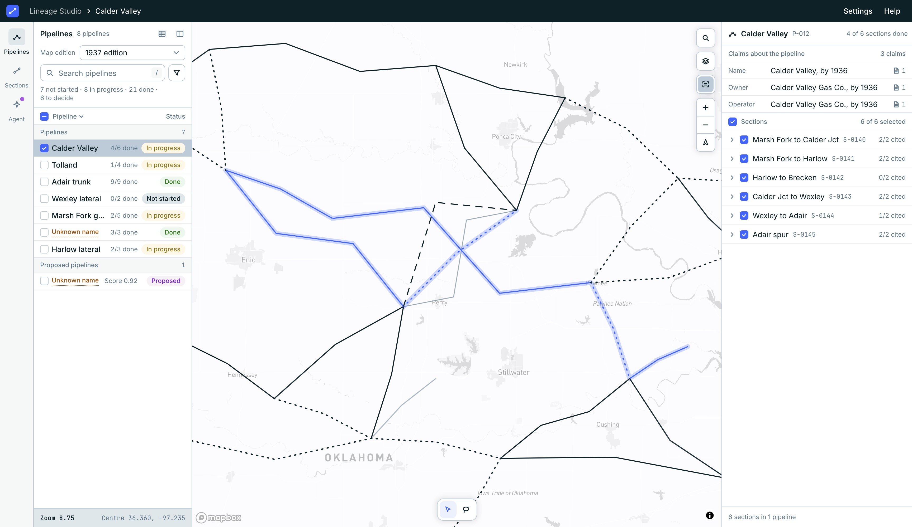
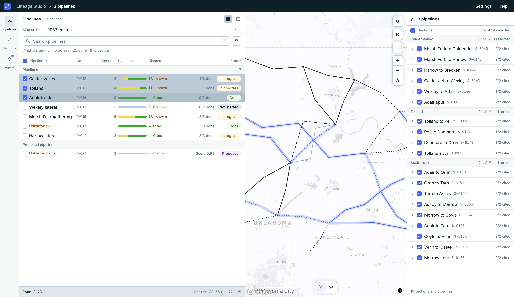
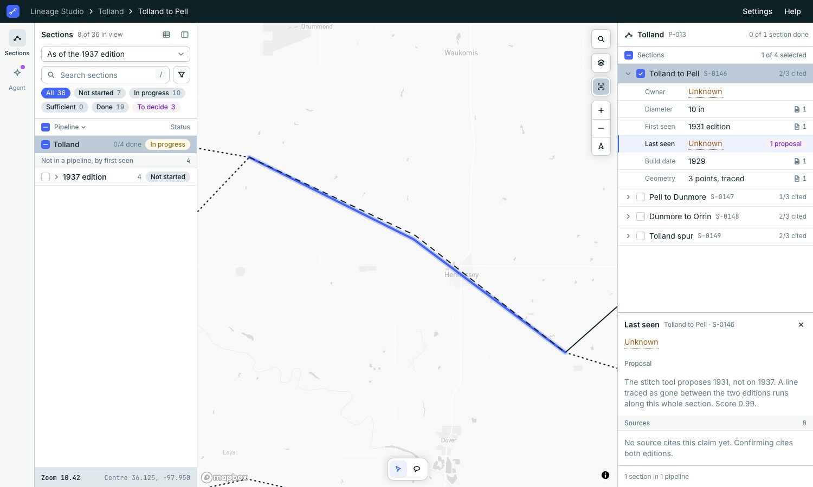

<div align="center">

# Lineage Studio

**The review app of [Lineage](https://github.com/line-age/controlplane).**<br>
Traced pipeline sections on a map, with the claims recorded about each one and the sources behind them.


[Quick start](#quick-start) · [Docker](#run-in-docker) · [Real data](#real-data-from-store) · [Keys](#keys) · [Develop](#develop) · [Not there yet](#not-there-yet)



</div>

> [!NOTE]
> **Status: early, read-only.** One screen so far. It runs on an invented sample network,
> or on a local [store](https://github.com/line-age/store). Nothing can be edited, and the
> Agent panel does not answer.

## In this repo

| Path | What |
| --- | --- |
| `frontend/` | The app: React 19, TypeScript, Vite, Tailwind v4, shadcn/ui, Mapbox GL JS |
| `compose.yaml` | Builds the app and serves it with nginx, on the sample |
| `compose.store.yaml` | The same, reading a local store |
| `docs/screenshots/` | The images on this page |

## What the screen has

- **Status.** Every section is Not started, In progress, Sufficient or Done, worked out
  from its claims: sufficient when the required attributes (Owner, Diameter and Build
  date unless Settings says otherwise) are cited, done when it is also in a pipeline.
- **List.** Pipelines, then the sections in no pipeline, grouped by the map edition that
  first shows them. A pipeline says how many of its sections are done ("4/6 done").
  One line under the search says how many sections of the whole edition are at each
  status; moving the map never changes it. A filter button beside the search opens
  every filter on one screen: status, pipeline, first seen, US state, company,
  diameter, build date, date added and which claims are Unknown. The ones that are on
  show as chips under the search. Search by pipeline, section, code or value.
- **Table.** Drag the list wider, or press the table button, and it adds the code, the
  section count, the split by status and a column per required attribute. The table
  holds the whole edition, whatever the map shows.
- **Map edition.** One select at the top of the list: the year the network is shown
  as of. It is a lens, not a filter.
- **Map.** One line per section, solid or dotted by its status. A layers button holds
  what the map draws and the line key; another makes the list follow the map or not.
  When it follows, the list header says how much is in view ("8 of 36 in view").
- **Link.** The edition, status, filters, search, map position and the one section in
  focus are in the address bar, so a copied link opens the same view.
- **Settings.** Which attributes must be cited, and which statuses are drawn solid. Kept
  in the browser.
- **Selection.** Tick rows, click lines or draw a lasso loop. It can span pipelines. The
  right panel lists the selected sections by pipeline, each with its required claims
  cited ("2/3 cited"). Click a section to read its claims and their sources; that does
  not change the selection, and the map draws the section being read heavier.
- **Agent panel.** Takes a selection as attachments to a message. Nothing is sent.
- **Panel button.** Hides both side panels; the same button on the map brings them back.
- **Help.** A ten-step tour of the screen starts on a first visit; Help in the top bar
  has the same pages, a list of the words, and runs the tour again.



## Quick start

```sh
cd frontend
pnpm install
cp .env.example .env.local   # put your Mapbox public token in it
pnpm dev
```

Needs Node 22 and pnpm 10.

The map needs a Mapbox public access token (`VITE_MAPBOX_TOKEN` in `.env.local`, which
git ignores). Map use is under Mapbox's terms and is billed to the account the token
belongs to. Without a token the app still runs: the lists and panels work and the map
area says what is missing.

## Run in Docker

```sh
docker compose --env-file frontend/.env.local up --build
```

Then open <http://localhost:8080>. This builds the app and serves it with nginx; no Node
or pnpm needed. The Mapbox token is read from the env file while the image builds and
ends up in the bundle, as it does in any build. Leave `--env-file` off and the app still
runs without the map. Set `STUDIO_PORT` to use another port.

## Real data from store

Studio can read a running [store](https://github.com/line-age/store) instead of the
sample. Start store with its own `docker compose up -d` (keep its folder named `store`),
make a token, and put it in `frontend/.env.local`:

```sh
docker compose -f ../store/compose.yaml exec -T api \
  lineage-store token create studio --pipeline studio@local | tail -1
# frontend/.env.local:  STORE_TOKEN=<that token>
```

Then, in a container:

```sh
docker compose -f compose.yaml -f compose.store.yaml --env-file frontend/.env.local up --build
```

or with the dev server: add `VITE_DATA_SOURCE=store` to `frontend/.env.local` and run
`pnpm dev`. Store's address is `STORE_URL` (default `http://localhost:47110` for the dev
server, `http://api:8000` in the container).

The browser never holds the token. The app asks its own origin at `/store`, and the dev
server or nginx passes the request on with the token added. If store cannot be reached,
refuses the token or answers in a form the app does not understand, the screen says
which; it never falls back to the sample.

Store has no pipelines yet, only sections. So Studio opens on the Sections list, with the
sections under the map edition that first shows each one, and the Pipelines list says
there are none. A pipeline is a `line` in store; once a person has confirmed a section
part of one, it shows in the Pipelines list with its own name, owner and operator, and a
`part_of` link that is only proposed shows as a proposal. An attribute store has no
accepted claim for is Unknown.

Each source says what it does for a claim: a map is "Shown on" or "Not on", a text
"States". A map comes with its edition and the date it is as of, and a status that
rests on a map reads "Shown by" that date, never "Operational". Where a later map no
longer shows a section, or part of one, store proposes an end or a cut. Studio shows
it as a proposal on Last seen or on Geometry, with the tool and its score, and draws
the line traced as gone on the map while you read it. Last seen stays Unknown until a
person confirms the end in store, which Studio cannot do yet. Loading asks store once
per section, so a large network takes a while to appear.



Real data stays on your machine: never in this repository, its tests or its
screenshots.

## Data

The app reads `frontend/public/fixtures/sample.json`, a small invented network. Nothing
in it is a real pipeline, company or source. To load your own file without changing
code, see [`frontend/docs/fixtures.md`](frontend/docs/fixtures.md).

## Keys

| Key | Does |
| --- | --- |
| `/` | Jump to the search box |
| `V` / `L` | Select tool / Lasso tool |
| `Shift` while drawing a lasso | Add to the selection |
| `Space` on a row | Tick or untick it |
| `Enter` on a row | Select just that one |
| `Esc` | Cancel a loop, close the Ask bar, clear a search |

## Develop

```sh
pnpm check   # tokens, types, lint, format, tests
pnpm build
```

| Path | What |
| --- | --- |
| `frontend/src/screens/studio/` | The Studio screen: panels, map, store |
| `frontend/src/components/` | Lineage parts any screen can use |
| `frontend/src/components/ui/` | shadcn components, added by the CLI |
| `frontend/src/data/` | Schema, loader and derived values |
| `frontend/src/data/store/` | Reading the Lineage store and turning its answers into the same schema |
| `frontend/src/styles/tokens.css` | Theme generated from the Figma variables |

The design lives in Figma and the code follows it. Rules for working in this repo,
for people and for coding agents, are in [`frontend/AGENTS.md`](frontend/AGENTS.md);
more detail on running and tokens is in [`frontend/README.md`](frontend/README.md).

## Not there yet

- Writing to store: reading it is all there is.
- Deciding on a proposed end or cut, and a list of the lines traced as gone that match
  no section.
- Placing sections in pipelines, and deciding on a proposed one.
- Editing, and accepting or rejecting what the Agent proposes.
- An Agent that answers. A person can already ask: right click a section, a claim, a
  source or a proposal for a question that only reads. The question is kept in the chat
  with a line saying the Agent cannot answer yet; nothing is sent anywhere.
- Notes on the map, the claim detail area.
- Settings shared by a project: they are kept in each browser.

## Licence

No licence has been chosen yet.
