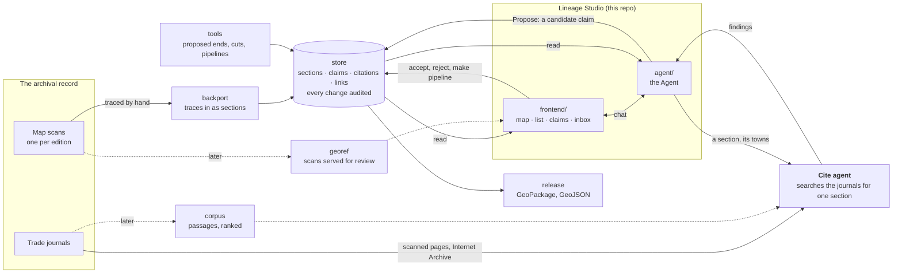
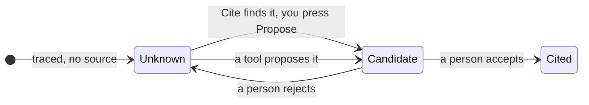

<div align="center">

# Lineage Studio

**The review app of [Lineage](https://github.com/line-age/controlplane).**<br>
Traced pipeline sections on a map, with the claims recorded about each one and the sources behind them.


[What it is for](#what-studio-is-for) · [The Agent and Cite](#the-agent-and-cite) · [Run it](#run-it) · [Develop](#develop) · [Not there yet](#not-there-yet)


<sub>On the invented sample network. Nothing in it is a real pipeline, company or source.</sub>

</div>

> [!NOTE]
> **Status: early.** One screen, on an invented sample or a local
> [store](https://github.com/line-age/store). No sign-in yet.

## What Studio is for

Traced lines say nothing about who owned a pipeline, how wide it was or when it was
built. Studio is where a person adds those facts, each with the source that says so, or
leaves them Unknown. Machines propose; a person decides.

| Step        | What you do                                        | Where                       |
| ----------- | -------------------------------------------------- | --------------------------- |
| **Preview** | See the network, what is cited and what is Unknown | Map, list, table, filters   |
| **Search**  | Ask the Agent what the sources say about a section | Agent chat, right-click     |
| **Cite**    | Open the source behind any claim                   | Claim rows, citation pop-up |
| **Edit**    | Make pipelines from sections                       | Right-click menu            |
| **Review**  | Accept or reject what tools and the Agent proposed | The Agent's inbox           |



Solid lines are built; dotted ones are planned. Components are described in
[controlplane](https://github.com/line-age/controlplane/blob/main/components.md).

## The Agent and Cite

**The Agent** (`agent/`) answers questions in the chat about the sections you attach.
It reads only store: every sentence names the claim it rests on, and where store has
nothing it says "Store does not say". Code checks each answer before it is shown.

**The Cite agent** finds what store does not know yet. When you ask the Agent to look
something up, it asks you for towns along the line and hands the section to Cite. Cite
searches scanned trade journals and returns findings: the page's own words, the passage
marked on the page, a link, and why it may be wrong.

Neither writes on its own. **Propose** on a finding saves it to store as a candidate;
it counts only once a person accepts it in the inbox.



## Run it

On the sample (needs Node 22, pnpm 10 and a Mapbox public token):

```sh
cd frontend
pnpm install
cp .env.example .env.local   # VITE_MAPBOX_TOKEN
pnpm dev
```

On a local store: start [store](https://github.com/line-age/store), add
`VITE_DATA_SOURCE=store` to `.env.local`, then `pnpm dev`.

With the Agent (store's data only):

```sh
cd agent
cp .env.example .env   # ANTHROPIC_API_KEY, STORE_URL, CITE_URL, STORE_CITE_TOKEN
uv sync && uv run python serve.py   # port 47190
```

In Docker: `docker compose --env-file frontend/.env.local up --build`, then
<http://localhost:8080>. Add `-f compose.yaml -f compose.store.yaml` for store.

Keep store and the Agent on your own machine: there is no sign-in. Real data never goes
into this repository. More in [`frontend/README.md`](frontend/README.md) and
[`agent/README.md`](agent/README.md).

## Develop

```sh
cd frontend && pnpm check     # tokens, types, lint, format, tests
cd agent && uv run pytest -q  # offline
```

The design lives in Figma and the code follows it. Rules for people and coding agents:
[`frontend/AGENTS.md`](frontend/AGENTS.md), [`agent/AGENTS.md`](agent/AGENTS.md).

## Not there yet

- Sign-in and people.
- Typing a claim by hand; deciding a proposed cut.
- The Agent on the sample, and in the Docker image.
- Saving changes on the sample (memory only).

## Licence

No licence has been chosen yet.
