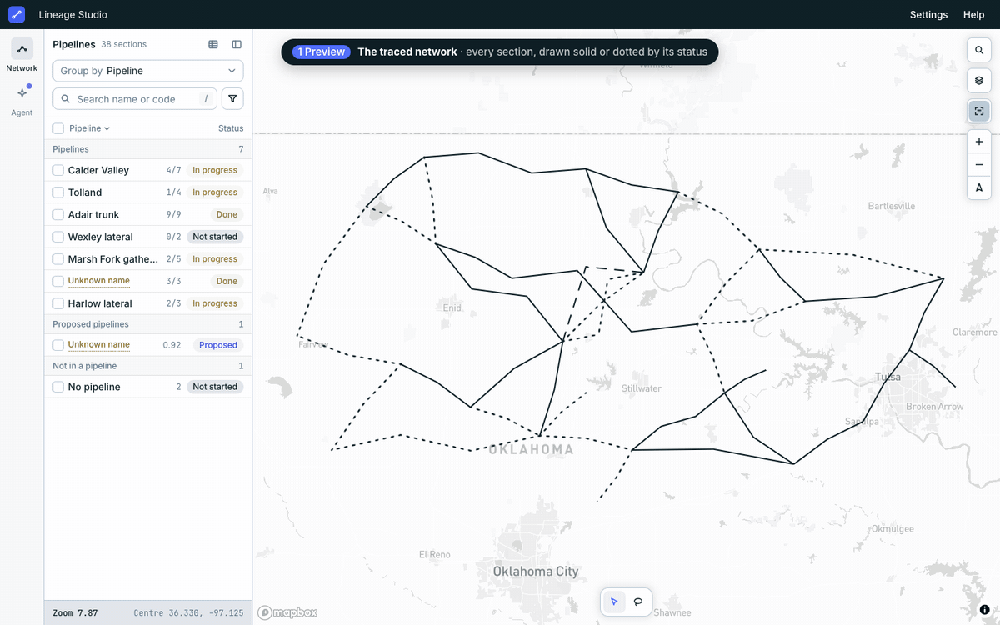
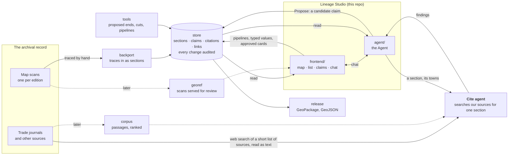
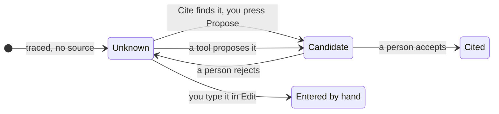

<div align="center">

# Lineage Studio

**The review app of [Lineage](https://github.com/line-age/controlplane).**<br>
Traced pipeline sections on a map, with the claims recorded about each one and the sources behind them.


[What it is for](#what-studio-is-for) · [The Agent and Cite](#the-agent-and-cite) · [Run it](#run-it) · [Develop](#develop) · [Not there yet](#not-there-yet)



<sub>On the invented sample network. Nothing in it is a real pipeline, company or source.</sub>

</div>

> [!NOTE]
> **Status: early.** One screen, on an invented sample or a local
> [store](https://github.com/line-age/store). On store's data a person signs in with
> GitHub.

## What Studio is for

Traced lines say nothing about who owned a pipeline, how wide it was or when it was
built. Studio is where a person adds those facts, each with the source that says so, or
leaves them Unknown. Machines propose; a person decides.

| Step        | What you do                                                | Where                                    |
| ----------- | ---------------------------------------------------------- | ---------------------------------------- |
| **Preview** | See the network, what is cited and what is Unknown         | Map, list, filters, a card on hover      |
| **Ask**     | Ask the Agent what is saved about a section or the network | Agent chat, right-click and Ask          |
| **Cite**    | Open the sources behind any claim                          | Claim rows, the sources pop-up           |
| **Edit**    | Make and edit pipelines, type a section's values           | Right-click menu, each in its own window |
| **Approve** | Approve a change or a search the Agent prepared as a card  | Agent chat                               |
| **Propose** | Save what a search of our sources found, as a proposal     | The finding's card in the chat           |

The Help button in the top bar runs a tour of the screen and has a page on each area.



Solid lines are built; dotted ones are planned. Components are described in
[controlplane](https://github.com/line-age/controlplane/blob/main/components.md).

## The Agent and Cite

**The Agent** (`agent/`) answers questions in the chat: about the sections and pipelines
you attach, what surrounds a section, several sections taken together, and the network
as a whole by a rule ("Which pipelines have no owner?"). It reads only store: every
sentence names the claim it rests on, and where store has nothing it says "Store does
not say". Code checks each answer before it is shown.

**The Cite agent** finds what store does not know yet. When you ask the Agent to look
something up, it asks you for towns along the line and hands the section to Cite. Cite
searches the web, limited to a short list of sources, reads pages as text and returns
findings: the page's own words, a link, and how sure it is from 0 to 1, with the checks
behind that number. A result that scores too low is shown as a lead and cannot be
proposed. Every search says what was searched; our own corpus of the journals is asked
first and is not available yet.

Neither writes on its own. Everything that waits on a person is a card in the chat:

| Card            | When                                   | The press                                  |
| --------------- | -------------------------------------- | ------------------------------------------ |
| **Your change** | You ask for a change in words          | **Approve**: Studio makes it, as you       |
| **A search**    | You ask the Agent to look something up | **Search**: only then does Cite run        |
| **A finding**   | Cite found something                   | **Propose**: saved to store as a candidate |

Approve reads the data again first: a card whose sections moved since is out of date and
writes nothing. Not now on a search and Dismiss on a finding write and spend nothing.

A candidate counts only once a person accepts it.



## Run it

On the sample (needs Node 22, pnpm 10 and a Mapbox public token):

```sh
cd frontend
pnpm install
cp .env.example .env.local   # VITE_MAPBOX_TOKEN
pnpm dev
```

On a local store: start [store](https://github.com/line-age/store) with the fake GitHub
in [`dev/fake-github`](dev/fake-github), add `VITE_DATA_SOURCE=store` and
`VITE_AUTH=local` to `.env.local`, then `pnpm dev`. You are "Local developer", who reads
and decides. With a sign-in gate in front (`GATE_URL`), a person signs in with GitHub
and must be in the team; the gate is not in this repository.

With the Agent (store's data only):

```sh
cd agent
cp .env.example .env   # ANTHROPIC_API_KEY, STORE_URL, STORE_CITE_TOKEN; CITE_URL for searches
uv sync && uv run python serve.py   # port 47190
```

In Docker: `docker compose --env-file frontend/.env.local up --build`, then
<http://localhost:8080>. Add `-f compose.yaml -f compose.store.yaml` for store.

Keep store and the Agent on your own machine: the Agent's service has no sign-in of its
own, and a search with Cite and every answer spend on a paid model. Real data never goes
into this repository. More in [`frontend/README.md`](frontend/README.md) and
[`agent/README.md`](agent/README.md).

## Develop

```sh
cd frontend && pnpm check     # tokens, types, lint, format, tests and every story
cd agent && uv run pytest -q  # offline: no key, no network
```

The design lives in Figma and the code follows it. Rules for people and coding agents:
[`frontend/AGENTS.md`](frontend/AGENTS.md), [`agent/AGENTS.md`](agent/AGENTS.md).

## Not there yet

- Deciding what tools proposed (pipelines, ends, candidate claims): the Agent's inbox is
  built and switched off for now. Deciding a proposed cut is not built.
- Typing a date on store's data; a source for a value typed by hand (it reads "Entered
  by hand").
- The list as a table: built and switched off for now.
- The Agent on the sample, and in the Docker image.
- Saving changes on the sample (memory only).
- The sign-in gate itself, in this repository.

## Licence

No licence has been chosen yet.
