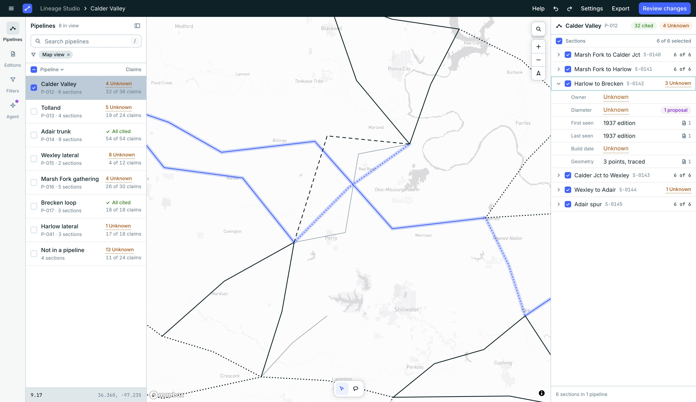
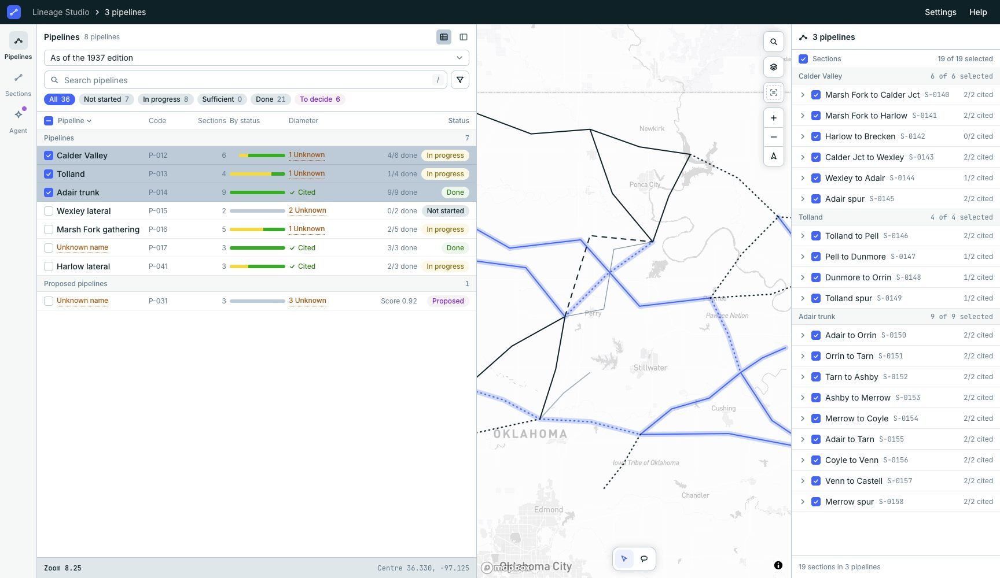
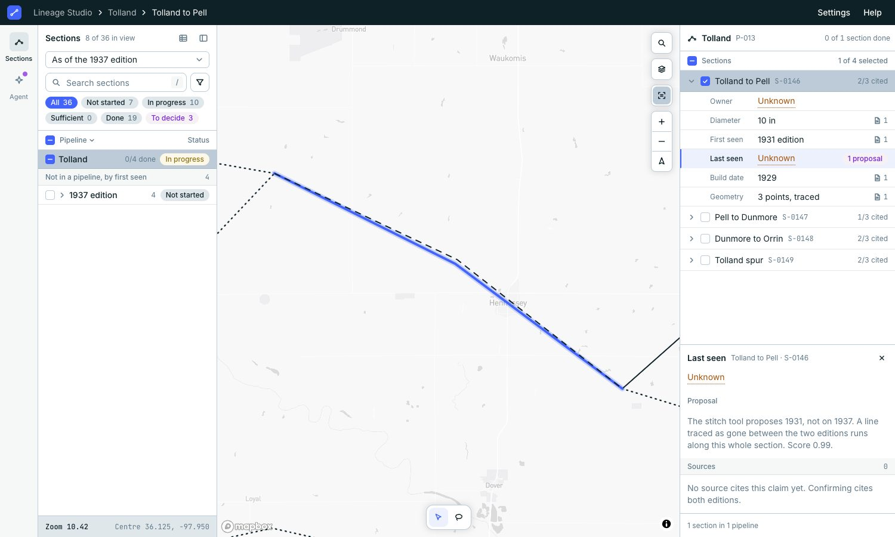

<div align="center">

# Lineage Studio

**The review app of [Lineage](https://github.com/line-age/controlplane).**<br>
Traced pipeline sections on a map, with the claims recorded about each one and the sources behind them.


[Quick start](#quick-start) · [Docker](#run-in-docker) · [Real data](#real-data-from-store) · [The Agent](#the-agent) · [Keys](#keys) · [Develop](#develop) · [Not there yet](#not-there-yet)



</div>

> [!NOTE]
> **Status: early.** One screen so far. It runs on an invented sample network, or on a
> local [store](https://github.com/line-age/store). A person can put sections into
> pipelines (on the sample, kept in memory until reload). On store's data they can
> also decide what tools proposed; the Agent answers from store, searches the journals
> with cite when asked, and proposes a finding or a pipeline only when you press its
> button. There is no sign-in yet: every change is made as store's local person.

## In this repo

| Path                 | What                                                                       |
| -------------------- | -------------------------------------------------------------------------- |
| `frontend/`          | The app: React 19, TypeScript, Vite, Tailwind v4, shadcn/ui, Mapbox GL JS  |
| `agent/`             | The Agent service behind the chat: Python, LangChain and LangGraph, Claude |
| `compose.yaml`       | Builds the app and serves it with nginx, on the sample                     |
| `compose.store.yaml` | The same, reading a local store                                            |
| `docs/screenshots/`  | The images on this page                                                    |

## What the screen has

- **Status.** Every section is Not started, In progress, Sufficient or Done, worked out
  from its claims: sufficient when the required attributes (Owner, Diameter and Build
  date unless Settings says otherwise) are cited, done when it is also in a pipeline.
- **List.** One list of every section, under "Network" in the rail, grouped the way
  "Group by" says. By pipeline: the pipelines, each with how many of its sections are
  done ("4/6"), then the proposed pipelines, then one row for the sections in no
  pipeline. By edition: one row per map edition, with the sections it is the first to
  show. A row's sections are listed on the right. Changing the grouping changes the
  rows only; the selection, the filters and the map stay. A filter button beside the
  search opens
  every filter on one screen: status, pipeline, first seen, US state, company,
  diameter, build date, date added and which claims are Unknown. The ones that are on
  show as chips under the search; the counts by status are in the filters. Search by
  pipeline, section, code or value.
- **Table.** Drag the list wider, or press the table button, and it adds the code, the
  section count, the split by status and a column per required attribute. The table
  holds the whole network, whatever the map shows.
- **Edition.** One year's printing of the source map. There is none to choose: the
  list and the map always show the whole network. To see it as an earlier map draws
  it, filter by "First seen", or group by edition.
- **Map.** One line per section, solid or dotted by its status. The map key says how
  each line is drawn; its two eyes show or hide the paths a tool proposed and, faint,
  the sections the filters leave out. Another button makes the list follow the map or
  not.
  When it follows, the list header says how much is in view ("8 of 36 in view").
- **Link.** The grouping, status, filters, search, map position and the one section in
  focus are in the address bar, so a copied link opens the same view.
- **Settings.** Which attributes must be cited, and which statuses are drawn solid. Kept
  in the browser.
- **Selection.** Tick rows, click lines or draw a lasso loop. It can span pipelines. The
  right panel lists the selected sections by pipeline, each with its required claims
  cited ("2/3 cited"). Click a section to read its claims and their sources; that does
  not change the selection, and the map draws the section being read heavier.
- **Pipelines.** Right-click a selection. Several sections: Make pipeline, or Add to a
  pipeline. One section: Change pipeline, to move it, take it out or start a new
  pipeline from it. The last two open a dock at the bottom of the right panel. On
  store's data nothing shows as done until store says so, and if store refuses, the
  dock says why; on the sample a change lasts until the page is reloaded.
- **Agent panel.** Takes a selection as attachments to a message. On store's data the
  Agent (`agent/`) answers from what store holds. Asked to find something in the
  sources, it asks for the towns along the line, has cite search the journals, and shows
  each finding with the page's own words, the passage marked on the page, a link to it,
  and why it may be in doubt. Propose on a finding writes it to store as a candidate
  claim; asked to make sections one pipeline, it offers a proposed pipeline, written
  only on its button. Nothing in the chat writes from words alone.
- **Inbox.** The Agent panel also lists what tools proposed and nobody has decided:
  proposed pipelines (decided whole), proposed ends, and candidate claims, cite's
  findings among them. Accept or reject each; the decision is the person's and goes to
  store on the button. No model is involved. A proposed cut is shown but cannot be
  decided yet.
- **Panel button.** Hides both side panels; the same button on the map brings them back.
- **Help.** A ten-step tour of the screen starts on a first visit; Help in the top bar
  has the same pages, a list of the words, and runs the tour again.



## Quick start

```sh
cd frontend
pnpm install
cp .env.example .env.local   # put your Mapbox public token in it
pnpm dev
```

Needs Node 22 and pnpm 10.

The map needs a Mapbox public access token (`VITE_MAPBOX_TOKEN` in `.env.local`, which
git ignores). Map use is under Mapbox's terms and is billed to the account the token
belongs to. Without a token the app still runs: the lists and panels work and the map
area says what is missing.

## Run in Docker

```sh
docker compose --env-file frontend/.env.local up --build
```

Then open <http://localhost:8080>. This builds the app and serves it with nginx; no Node
or pnpm needed. The Mapbox token is read from the env file while the image builds and
ends up in the bundle, as it does in any build. Leave `--env-file` off and the app still
runs without the map. Set `STUDIO_PORT` to use another port. It is
reachable from this machine only; `STUDIO_BIND=0.0.0.0` opens it to the network.

## Real data from store

Studio can read a running [store](https://github.com/line-age/store) instead of the
sample. Start store with its own `docker compose up -d` (keep its folder named `store`).
No token is needed: while there are no users, store takes a request with none as the
local person ("Local developer"), who can read and decide. Never expose such a store
beyond your own machine.

Then, in a container:

```sh
docker compose -f compose.yaml -f compose.store.yaml --env-file frontend/.env.local up --build
```

or with the dev server: add `VITE_DATA_SOURCE=store` to `frontend/.env.local` and run
`pnpm dev`. Store's address is `STORE_URL` (default `http://localhost:47110` for the dev
server, `http://api:8000` in the container). To open one area only, for a demo or a
network too large to load whole, set `VITE_STORE_BBOX=minx,miny,maxx,maxy` (WGS 84).

The app asks its own origin at `/store`, and the dev server or nginx passes the request
on. If store cannot be reached, refuses a request or answers in a form the app does not
understand, the screen says which; it never falls back to the sample.

A fresh store has no pipelines, only sections. So Studio opens grouped by edition, with
the sections under the map edition that first shows each one; grouped by pipeline they
are one row, "No pipeline", until someone makes pipelines from the right-click menu. A
pipeline is a `line` in store; once a person has confirmed a section part of one, it has
its own row with its name, owner and operator, and a `part_of` link that is only
proposed shows as a proposal. An attribute store has no accepted claim for is Unknown.
Every change carries a key made when the button is pressed, so a retry never makes a
second row.

Each source says what it does for a claim: a map is "Shown on" or "Not on", a text
"States". A map comes with its edition and the date it is as of, and a status that
rests on a map reads "Shown by" that date, never "Operational". Where a later map no
longer shows a section, or part of one, store proposes an end or a cut. Studio shows
it as a proposal on Last seen or on Geometry, with the tool and its score, and draws
the line traced as gone on the map while you read it. Last seen stays Unknown until a
person accepts the end in the Agent's inbox. Loading asks store once per section, so a
large network takes a while to appear.



Real data stays on your machine: never in this repository, its tests or its
screenshots.

## The Agent

The chat is answered by a separate service in `agent/`, on store's data only. Run it
beside store, then the dev server:

```sh
cd agent
cp .env.example .env   # ANTHROPIC_API_KEY; STORE_URL; optional CITE_URL, STORE_CITE_TOKEN
uv sync
uv run python serve.py # port 47190
```

The dev server passes `/agent` on to `AGENT_URL` (default `http://127.0.0.1:47190`).
The model is Claude Haiku 5.5 by default (`AGENT_MODEL`). The Agent reads store with no
token. Its one kind of write, a proposal on the person's button, uses
`STORE_CITE_TOKEN`, a pipeline token minted for `cite@<version>`, so what it writes
stays a candidate or a proposed link. Without `CITE_URL` it cannot search the journals
and says what it would have asked for. Tracing to LangSmith is off unless
`AGENT_TRACING=true`; leave it off on real data.

The service has no sign-in: keep its port on `127.0.0.1`. How it answers, the checks
every answer passes and its evals are in [`agent/README.md`](agent/README.md) and
[`agent/AGENTS.md`](agent/AGENTS.md).

## Data

The app reads `frontend/public/fixtures/sample.json`, a small invented network. Nothing
in it is a real pipeline, company or source. To load your own file without changing
code, see [`frontend/docs/fixtures.md`](frontend/docs/fixtures.md).

## Keys

| Key                           | Does                                             |
| ----------------------------- | ------------------------------------------------ |
| `/`                           | Jump to the search box                           |
| `V` / `L`                     | Select tool / Lasso tool                         |
| `Shift` while drawing a lasso | Add to the selection                             |
| `Space` on a row              | Tick or untick it                                |
| `Enter` on a row              | Select just that one                             |
| `Esc`                         | Cancel a loop, close the Ask bar, clear a search |

## Develop

```sh
cd frontend
pnpm check          # tokens, types, lint, format, tests
pnpm build

cd ../agent
uv run pytest -q    # offline: no key, no network
```

| Path                             | What                                                                      |
| -------------------------------- | ------------------------------------------------------------------------- |
| `frontend/src/screens/studio/`   | The Studio screen: panels, map, store                                     |
| `frontend/src/components/`       | Lineage parts any screen can use                                          |
| `frontend/src/components/ui/`    | shadcn components, added by the CLI                                       |
| `frontend/src/data/`             | Schema, loader, derived values and the changes a person can make          |
| `frontend/src/data/store/`       | Reading store into the same schema, and writing to it (`write.ts`)        |
| `frontend/src/styles/tokens.css` | Theme generated from the Figma variables                                  |
| `agent/contract/`                | JSON schemas for what Studio and the Agent send each other, with examples |
| `agent/evals/`                   | Scenario evals for the Agent, against a fake store and a fake cite        |

The design lives in Figma and the code follows it. Rules for working in this repo,
for people and for coding agents, are in [`frontend/AGENTS.md`](frontend/AGENTS.md);
more detail on running and tokens is in [`frontend/README.md`](frontend/README.md).

## Not there yet

- Sign-in and people: every change is made as store's local person, so never expose
  Studio, store or the Agent beyond your own machine.
- Deciding on a proposed cut, and a list of the lines traced as gone that match no
  section.
- Typing a claim's value by hand.
- Keeping a change on the invented sample: it is held in memory only.
- The Agent on the invented sample: there, a question is kept in the chat with a line
  saying the Agent cannot answer; it answers on store's data only.
- The chat in the Docker image: it has no `/agent` path yet, so the chat answers under
  `pnpm dev` only.
- Notes on the map, the claim detail area.
- Settings shared by a project: they are kept in each browser.

## Licence

No licence has been chosen yet.
