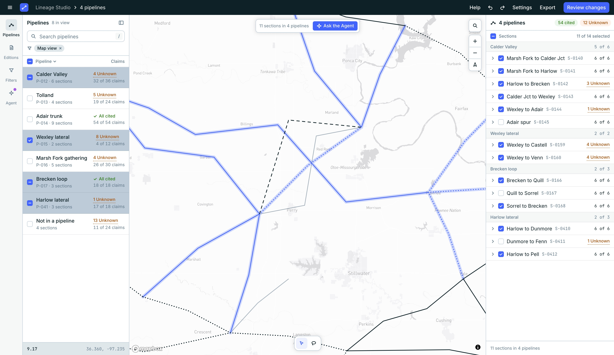

<div align="center">

# Lineage Studio

**A map desk for reviewing traced pipelines.**
See every section, which of its claims are cited and which are still Unknown,
and hand what you select to the Agent.

React 19 · TypeScript · Vite · Tailwind v4 · shadcn/ui · Mapbox GL JS


</div>

> [!NOTE]
> Early work. One screen, **Studio**, runs read-only: on an invented sample network by
> default, or on a local Lineage store. Nothing can be edited, and the Agent does not
> answer.

## What it does

### Cited or Unknown, never a guess

Every claim about a section (owner, diameter, build date, first and last seen, geometry)
either carries a source or is marked **Unknown** in words. On the map a solid line means
every claim is cited; a dotted line means something is still Unknown.

### Select by list, by click or by lasso

Tick pipelines in the list, click lines on the map, or draw a loop around an area. A
selection can span several pipelines; the right panel lists it grouped by pipeline, with
each section opening to its claims.



### Ask the Agent about what you selected

Any selection made on the map offers **Ask the Agent**. It opens the chat with the
selection attached as references, one per pipeline, and the cursor in the message box.

### Search and filters

Search by pipeline, section, code or value; type `unknown owner` to find sections whose
owner is Unknown. Narrow the list and the map by company, build date, the day a section
was added, or by which claims are Unknown.

### The whole map when you want it

One button in the left panel's header hides both side panels and leaves the rail. The
same button, floating at the top left of the map, brings them back. The selection stays.

### Editions

Each map edition is listed with how many of the sections it first shows are placed in a
pipeline. Choosing an edition shows the network as that map has it.

## Quick start

```sh
cd frontend
pnpm install
cp .env.example .env.local   # put your Mapbox public token in it
pnpm dev
```

Needs Node 22 and pnpm 10.

The map needs a Mapbox public access token (`VITE_MAPBOX_TOKEN` in `.env.local`, which
git ignores). Map use is under Mapbox's terms and is billed to the account the token
belongs to. Without a token the app still runs: the lists and panels work and the map
area says what is missing.

## Run in Docker

```sh
docker compose --env-file frontend/.env.local up --build
```

Then open <http://localhost:8080>. This builds the app and serves it with nginx; no Node
or pnpm needed. The Mapbox token is read from the env file while the image builds and
ends up in the bundle, as it does in any build. Leave `--env-file` off and the app still
runs without the map. Set `STUDIO_PORT` to use another port.

## Real data from store

Studio can read a running [store](https://github.com/line-age/store) instead of the
sample. Start store with its own `docker compose up -d` (keep its folder named `store`),
make a token, and put it in `frontend/.env.local`:

```sh
docker compose -f ../store/compose.yaml exec -T api \
  lineage-store token create studio --pipeline studio@local | tail -1
# frontend/.env.local:  STORE_TOKEN=<that token>
```

Then, in a container:

```sh
docker compose -f compose.yaml -f compose.store.yaml --env-file frontend/.env.local up --build
```

or with the dev server: add `VITE_DATA_SOURCE=store` to `frontend/.env.local` and run
`pnpm dev`. Store's address is `STORE_URL` (default `http://localhost:47110` for the dev
server, `http://api:8000` in the container).

The browser never holds the token. The app asks its own origin at `/store`, and the dev
server or nginx passes the request on with the token added. If store cannot be reached,
refuses the token or answers in a form the app does not understand, the screen says
which; it never falls back to the sample.

Store has no pipelines yet, only sections. So the list is titled **Sections** and groups
them by the map edition that first shows each one, and the **Editions** panel lists every
edition with how many of its sections are placed in a pipeline. Choose an edition there
to see the network as that map shows it. An attribute store has no accepted claim for is
Unknown. Real data stays on your machine: never in this repository, its tests or its
screenshots.

## Data

The app reads `frontend/public/fixtures/sample.json`, a small invented network. Nothing
in it is a real pipeline, company or source. To load your own file without changing
code, see [`frontend/docs/fixtures.md`](frontend/docs/fixtures.md).

## Keys

| Key | Does |
| --- | --- |
| `/` | Jump to the search box |
| `V` / `L` | Select tool / Lasso tool |
| `Shift` while drawing a lasso | Add to the selection |
| `Space` on a row | Tick or untick it |
| `Enter` on a row | Select just that one |
| `Esc` | Cancel a loop, close the Ask bar, clear a search |

## Develop

```sh
pnpm check   # tokens, types, lint, format, tests
pnpm build
```

| Path | What |
| --- | --- |
| `frontend/src/screens/studio/` | The Studio screen: panels, map, store |
| `frontend/src/components/` | Lineage parts any screen can use |
| `frontend/src/components/ui/` | shadcn components, added by the CLI |
| `frontend/src/data/` | Schema, loader and derived values |
| `frontend/src/data/store/` | Reading the Lineage store and turning its answers into the same schema |
| `frontend/src/styles/tokens.css` | Theme generated from the Figma variables |

The design lives in Figma and the code follows it. Rules for working in this repo,
for people and for coding agents, are in [`frontend/AGENTS.md`](frontend/AGENTS.md);
more detail on running and tokens is in [`frontend/README.md`](frontend/README.md).

## Not there yet

- Writing to store: reading it is all there is.
- Removals (lines a later map no longer shows) and the proposed links behind them.
- Placing sections in pipelines.
- Editing, and accepting or rejecting what the Agent proposes.
- An Agent that answers.
- Notes on the map, a table view, the claim detail area.

## Licence

No licence has been chosen yet.
