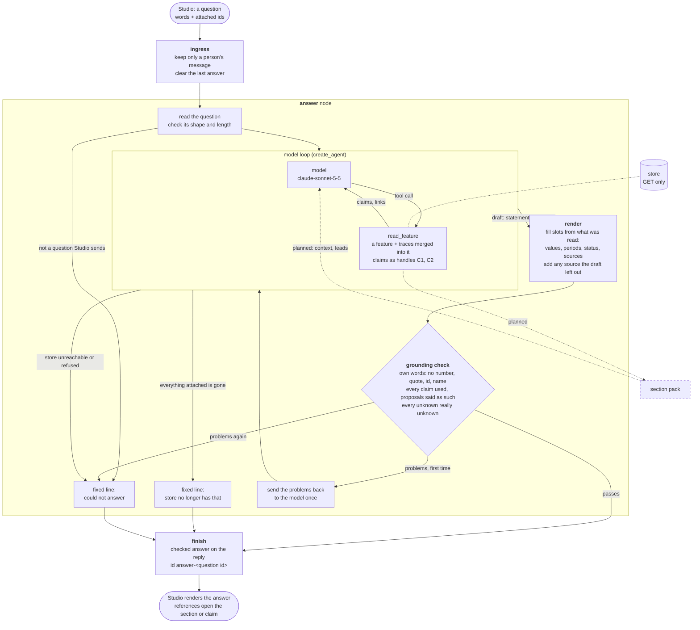
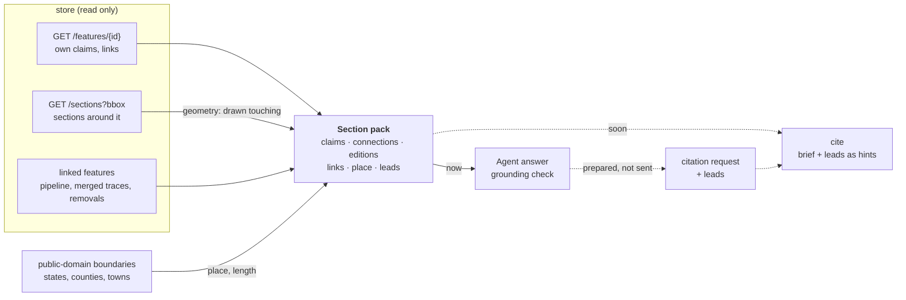

# The Studio Agent

The service that answers [Lineage Studio](../README.md)'s chat. It reads
[store](https://github.com/line-age/store) and says only what it read: every statement
names the claim, citation or link it rests on, and where store has nothing the answer is
"Store does not say". It writes nothing.

> **Status:** answers questions about the sections, pipelines, claims and proposals a
> person attaches (behaviours B1 and B2), with a code check on every answer. Studio's chat
> talks to it when Studio runs on store's data. Section context and leads are planned
> (below). Whole-network questions, follow-ups and `cite` are not built yet.

```sh
cd agent
uv sync
uv run pytest -q                                   # offline: no key, no network
uv run python serve.py                             # serve it on this machine, port 47190
```

It is built on LangChain's agent loop inside a LangGraph graph, served with
`langgraph dev`, which is a development server: right beside a local store, not for a
hosted deployment. Deep Agents (planning, working files) comes in with whole-network
questions. The service has no sign-in, so keep its port on `127.0.0.1`. Tracing to
LangSmith is off unless `AGENT_TRACING=true`.

## The graph

What runs for one question. Solid is built; dotted is planned.



## Planned: section context

A section's own claims are often only its route and a status. To say more about it, the
Agent will gather one **section pack**: its claims, what it is drawn touching, the map
editions that show it, its links and pipeline, and where it lies. From these it may draw
**leads**, marked "Not in store", which point at what to look for. The same pack, unchanged,
becomes `cite`'s brief for the section, and the leads its hints, once `cite` is attached.



How each kind of statement is marked in an answer:

| Kind | Comes from | Shown as |
| --- | --- | --- |
| Claim | store, accepted | the value with its source |
| Proposal | store, candidate | "proposed by a tool (or a person), not decided yet", with its source |
| Worked out | code, from geometry or public boundaries | marked worked out, with what it was worked out from |
| Lead | the Agent, from the above | "Not in store", with what it rests on; never proposed to store |
| Unknown | store holds nothing | "Store does not say" |

A section drawn touching another is a clue, not a fact: two traced lines meeting on a map
does not prove the pipes joined.

Rules, layout and how Studio talks to it: [AGENTS.md](AGENTS.md).
