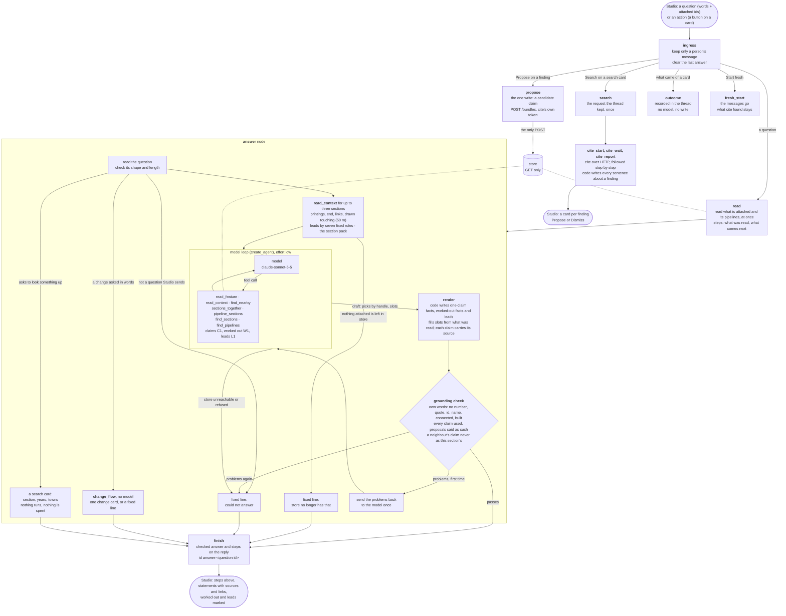

# The Studio Agent

The service that answers [Lineage Studio](../README.md)'s chat: it reads
[store](https://github.com/line-age/store) and says only what it read.

## Overview

Every statement names the claim, citation or link it rests on, and where store has
nothing the answer is "Store does not say". It writes one thing only, on a person's
button: a finding they pressed Propose on, as a candidate claim. Built with LangChain's
agent loop (`create_agent`) inside a LangGraph graph, on Anthropic's Claude (Sonnet 5.5
by default), served by the LangGraph server. Deep Agents (planning, working files) is
not used yet.

## Features

- **Questions about what is attached:** sections, pipelines, claims and proposals.
- **What surrounds a section:** which printings show it, what ends it, its links, what
  it is drawn touching, and leads on where to look next, found by fixed rules.
- **Across the network:** what is nearby, the towns and states a line runs through and
  its length, several sections taken together, a pipeline as a whole, the network by a
  rule.
- **Follow-ups** on the last question, and what a word means.
- **A code check on every answer** before it is shown; a draft that fails goes back to
  the model once, then a fixed line.
- **A change asked for in words** comes back as a card that Studio makes on Approve.
- **Searching our sources with `cite`** waits for the person's Search; a finding
  reaches store only on Propose.

## Quick start

### Prerequisites

- Python 3.12 and [uv](https://docs.astral.sh/uv/).
- A store to read: a local one (`STORE_URL`), or the invented world for QA
  (`uv run python -m evals.serve_world`).
- An Anthropic API key, for anything but the offline tests.

### Install

```sh
cd agent
uv sync
uv run pytest -q              # offline: no key, no network, no model call
```

### Configuration

Copy `.env.example` to `.env` (git ignores it). No key or token has a default.

| Variable | What | Default |
| --- | --- | --- |
| `ANTHROPIC_API_KEY` | The model's key | none |
| `AGENT_MODEL` | The model | `anthropic:claude-sonnet-5-5` |
| `STORE_URL` | Store, read with GET only | `http://localhost:47110` |
| `STORE_TOKEN` | A read token for store; empty sends none | empty |
| `STORE_CITE_TOKEN` | The one write: a pipeline token for `cite@<version>` | empty: Propose fails |
| `CITE_URL` | cite's Agent Server; empty means no search | empty |
| `AGENT_TRACING` | The only switch for tracing to LangSmith | `false` |
| `LANGSMITH_API_KEY`, `LANGSMITH_AGENT_ID`, `LANGSMITH_AGENT_ENVIRONMENT` | Where traces go | see `.env.example` |

### Running

```sh
uv run python serve.py        # the service on 127.0.0.1:47190
uv run python serve.py --qa   # on the invented world (.env.qa)
cd ../frontend && pnpm dev    # Studio, talking to it through its /agent path
```

Always start it with `serve.py`: it decides tracing before the server starts.

## Project structure

```txt
agent/
├── graph.py                 # what langgraph.json serves: the built graph
├── serve.py                 # starts the service, decides tracing
├── langgraph.json           # the graph, its env file, the allowed origin
├── src/
│   ├── agent/
│   │   ├── config.py        # settings from the environment, every limit
│   │   ├── state.py         # what the graph keeps in a thread
│   │   ├── deps.py          # store, model, loop, cite, writer: what the nodes share
│   │   ├── loop.py          # the model loop, built once
│   │   ├── graph.py         # build_graph: wiring only
│   │   ├── question.py      # the question a message carries
│   │   ├── prefetch.py      # store, with the attached things already fetched
│   │   ├── reply.py         # the reply and its steps
│   │   └── nodes/           # ingress, read, answer, change, cite, actions
│   ├── middleware/          # what wraps the loop: limits, prompt caching
│   ├── tools/               # the model's tools, defined once; the question's context
│   ├── prompts/             # system, retry
│   ├── answer/              # schemas, render, prose, grounding
│   ├── worked_out/          # context, geometry, leads, pack, together, network, states, places
│   ├── flows/               # change_flow, cite_flow, cite_input, cite_result
│   └── clients/             # store_client, store_writer, cite_client, value_rules
├── contract/                # JSON Schemas shared with Studio, store and cite
├── data/                    # US places and states
├── evals/                   # cases, invented worlds, fakes, runs
└── tests/
    ├── unit/
    └── evals/
```

## How it works

1. **ingress** keeps only a person's message and clears the last answer. A button on a
   card (Propose, Search, what came of a card, Start fresh) goes to its own node, with
   no model.
2. **read** reads what is attached and its pipelines, at once, and says so in the steps
   Studio shows.
3. **answer** reads the question. A change asked in words is code's card; otherwise the
   attached things and the first three sections' context are read before the model
   starts.
4. **The model loop** drafts: it may call the tools (each read is its question's own,
   passed as the loop's context), and picks claims, worked-out facts and leads by handle
   (C1, W1, L1).
5. **render** writes the values from what was read; **the grounding check** passes the
   answer or sends it back once.
6. **finish** puts the checked answer and its steps on the reply. An answer that asks
   for a search gets a search card; `cite_start`, `cite_wait` and `cite_report` run it
   only after the person presses Search.




### What an answer is made of

What it is and why: the controlplane's
[components.md, The Agent service](https://github.com/line-age/controlplane/blob/main/components.md#the-agent-service).
How each kind of statement is shown in an answer:

| Kind | Comes from | Shown as |
| --- | --- | --- |
| Claim | store, accepted | the value in a sentence, its source beside it |
| Proposal | store, candidate | "A tool (or a person) proposed ...; nobody has decided", its source beside it |
| Worked out | code, from the maps, the links or the traced lines | marked "Inferred" (hover says what it means), with what it rests on |
| Lead | code, by fixed rules over the above; the model only picks it | marked "Lead, not in store", with what it rests on; never written to store |
| Unknown | store holds nothing | "Store does not say" |

A section drawn touching another is a clue, not a fact: two traced lines meeting on a map
do not prove the pipes joined. The same pack of context is kept whole as `cite`'s brief
(`contract/section-pack.schema.json`, golden example in `contract/examples/`).

## Deployment

The LangGraph server owns what is not the graph: threads and their checkpoints, runs,
streaming, and (later) sign-in. `langgraph dev` is a development server: right beside a
local store, not for a hosted deployment. The service has no sign-in, so keep its port on
`127.0.0.1`; `langgraph.json` allows no other web origin. The `Dockerfile` serves it for
a local stack. Tracing to LangSmith is off unless `AGENT_TRACING=true`; a trace holds
what the Agent read from store.

## Evals and spend

Every behaviour is built eval first: [evals/README.md](evals/README.md). Anything that
calls the model costs money and is never run without asking first, with the questions,
model calls, model and price stated ([AGENTS.md](AGENTS.md)). The tests and a replayed
eval run cost nothing.

## Licence

No licence has been chosen yet.

Rules, and how Studio talks to it: [AGENTS.md](AGENTS.md).
