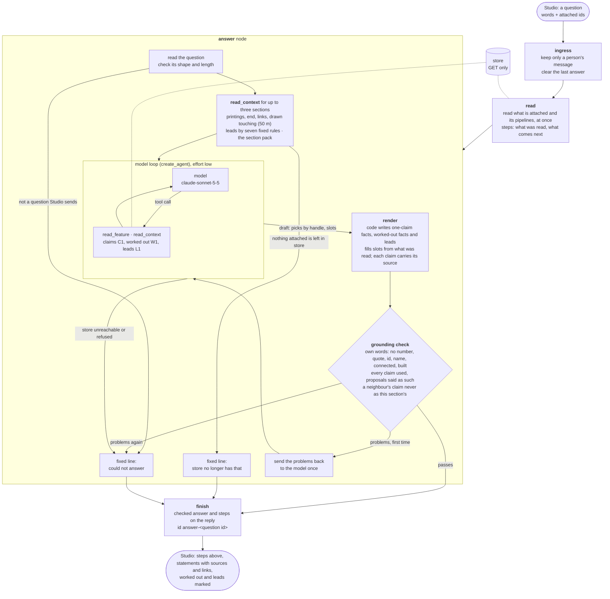

# The Studio Agent

The service that answers [Lineage Studio](../README.md)'s chat. It reads
[store](https://github.com/line-age/store) and says only what it read: every statement
names the claim, citation or link it rests on, and where store has nothing the answer is
"Store does not say". It writes nothing.

> **Status:** answers questions about the sections, pipelines, claims and proposals a
> person attaches (B1, B2), and says what surrounds a section: which printings show it,
> what ends it, its links, what it is drawn touching, and leads on where to look next
> (B17 to B20). Every answer passes a code check. Studio's chat talks to it when Studio
> runs on store's data. Whole-network questions, follow-ups and `cite` are not built yet.

```sh
cd agent
uv sync
uv run pytest -q                                   # offline: no key, no network
uv run python serve.py                             # serve it on this machine, port 47190
```

It is built on LangChain's agent loop inside a LangGraph graph, served with
`langgraph dev`, which is a development server: right beside a local store, not for a
hosted deployment. Deep Agents (planning, working files) comes in with whole-network
questions. The service has no sign-in, so keep its port on `127.0.0.1`. Tracing to
LangSmith is off unless `AGENT_TRACING=true`.

## The graph

What runs for one question.



## Section context

What it is and why: the controlplane's
[components.md, The Agent service](https://github.com/line-age/controlplane/blob/main/components.md#the-agent-service).
How each kind of statement is shown in an answer:

| Kind | Comes from | Shown as |
| --- | --- | --- |
| Claim | store, accepted | the value in a sentence, its source beside it |
| Proposal | store, candidate | "A tool (or a person) proposed ...; nobody has decided", its source beside it |
| Worked out | code, from the maps, the links or the traced lines | marked "Worked out", with what it rests on |
| Lead | code, by fixed rules over the above; the model only picks it | marked "Lead, not in store", with what it rests on; never written to store |
| Unknown | store holds nothing | "Store does not say" |

A section drawn touching another is a clue, not a fact: two traced lines meeting on a map
do not prove the pipes joined. The same pack of context is kept whole as `cite`'s brief
(`contract/section-pack.schema.json`, golden example in `contract/examples/`).

Rules, layout and how Studio talks to it: [AGENTS.md](AGENTS.md).
