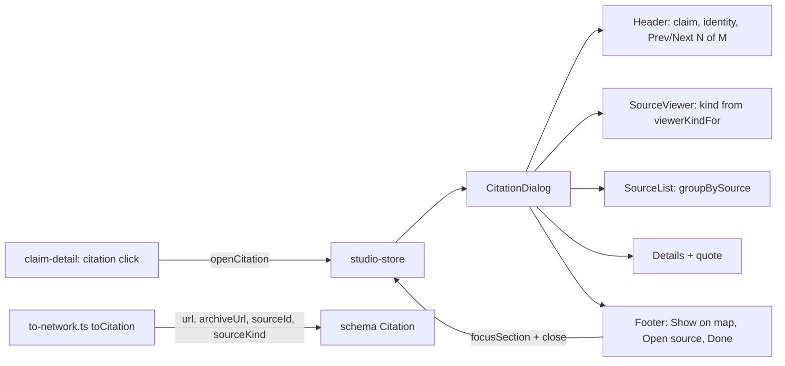

# Citation preview pop-up (option A) - Plan

## Goal Capsule

Clicking a citation in Lineage Studio opens a centred pop-up. The source is on the left with the cited place marked. The source list, details and quote are on the right. Previous and Next step through the claims, and the footer has Show on map, Open source and Done. This replaces the preview in the right sidebar. Phase 1 ships the pop-up on today's real data, which is all scanned maps. Phase 2 adds the website viewer with several passages, which is the main case to come.

- Source of truth: Figma file `hbofXZlZNRK4L1MbG7wQsf`, section "15. Citation preview pop-up (option A)".
- Rules: `studio/frontend/AGENTS.md` and the repo skills in `studio/frontend/.agents/skills` (including `lineage-figma`).
- Store data stays on the machine. It never goes into a test, fixture, screenshot or commit.

## Product Contract

### Summary

A citation opens a pop-up window instead of expanding inline in the claim detail. The window shows the evidence where it lives (a scan, a web page or text), lists each source once with its passage count, and lets the reader move from claim to claim without closing it.

### Problem Frame

Today a citation expands as a short field list at the bottom of the properties panel (`panels/claim-detail.tsx`). The reader can't see the source itself, a source cited in several places is listed again for each one, and checking the next claim means closing the citation and opening another. The owner chose a pop-up (option A) over a wider sidebar on 2026-11-15.

Real store today: 2,688 citations, all `map_sheet` scans, with no quote, url or archived copy. There are 2,506 unnamed gas sections, each with a route claim and a status claim that share one citation. Web sources are coming and will be most of them (owner, 2026-11-15).

### Key Decisions

- **KD1. Pop-up, not a wider sidebar.** Governs R1, R2. (session-settled: user-directed — chosen over a wider right sidebar: owner picked option A on 2026-11-15)
- **KD2. Web sources are the main case to design for.** Governs R7, R8. (session-settled: user-directed — chosen over scan-first: owner said web sources will be most of them at first)
- **KD3. One source can hold several passages, and one claim can cite several sources.** Governs R5, R8. (session-settled: user-directed — owner: "multiple sources, or same source but different place")
- **KD4. A person's edit counts without a citation, but an agent's claim needs one.** Governs R11. (team memory, owner 2026-11-15)

### Requirements

- **R1.** Clicking a citation in the claim detail opens a centred modal dialog. It no longer expands inline. Figma 315:2.
- **R2.** The header shows the attribute and value, a feature identity line (for example "Unnamed gas section" when the feature has no name), and Previous and Next claim buttons with an "N of M" counter. Previous is disabled on the first claim and Next on the last. Figma 315:359.
- **R3.** Previous and Next walk the cited claims of the open section in attribute order, and the arrow keys do the same. Claims with no citation (an Unknown value) are skipped. The counter M counts only the claims navigation visits, and arriving at a claim selects its first citation. Arrow keys do not step claims while focus is in the source list or the passage stepper. Esc and Done close the window. The footer shows these key hints.
- **R4.** Show on map closes the window, puts the claim's section in focus and fits the map to it. Open source opens the source's address in a new tab. It is hidden (or disabled, see OQ5) when the citation has no address.
- **R5.** The source list is built from the open claim's citations. It shows each source once, with "N passages" when that claim cites it in more than one place. Selecting a source selects its first passage and switches the viewer and the details. Figma SourceRow 331:13191, frame 315:320.
- **R6.** The details show only what the data holds, in the order AGENTS.md sets. A long title ends with an ellipsis and a tooltip shows the full title. A scan with no quote says "No quote, scanned map". When the citation backs more than one claim, a note says "Supports N claims".
- **R7.** The left pane is a source viewer. Figma SourceViewer 336:13243 has four kinds: web, text, scan and unavailable. Phase 1 ships unavailable, which is what today's scans show until Studio can serve scan images (OQ1). Phase 2 ships web, and a citation with only a quote renders in the web viewer as a single marked passage, so no separate text pane is built. The scan kind is built together with scan serving.
- **R8.** The web viewer shows the cited passage marked, with a "Passage N of M" stepper that is separate from claim navigation. Figma 315:2, 315:320. This is phase 2.
- **R9.** A route claim never shows raw geometry. It reads as "Traced line" (`valueOf` already does this).
- **R10.** Icon buttons have `aria-label`s and focus is trapped in the dialog. Esc and Done return focus to the citation that opened it, even after stepping claims. Show on map leaves focus on the map.
- **R11.** A claim without citations shows no citation and opens no pop-up. Studio already shows an uncited accepted claim as Unknown (`schema.ts`, `to-network.ts`), so the pop-up adds no rule. Nothing in it makes a citation required for human edits.
- **R12.** AGENTS.md, the Help tour and the README screenshots match the new behaviour.

### Scope Boundaries

- No store migration. `reads.py` already returns `url`, `archive_url`, `source_id` and `source_kind`.
- No editing or reviewing claims from inside the pop-up.
- No changes to the sidebar beyond removing the inline citation expansion.

### Deferred to Follow-Up Work

- Serving scan images to Studio, either from IIIF via `allmaps/` or from tiles, and the scan viewer (frame 315:333, ScanZoomControl) with it. Until then scans show the unavailable kind (OQ1).
- Fetching the archived page text for the web viewer (OQ2).

## Planning Contract

### Key Technical Decisions

- **KTD1. Build on the existing shadcn `Dialog` (Base UI) in `components/ui/dialog.tsx`.** It already handles focus trap, Esc and return focus. Header and footer follow the Figma DialogHeader and DialogFooter components. Implements R1, R3 and R10, per KD1.
- **KTD2. Pop-up state lives in `studio-store.ts`** as `openCitation: {sectionId, attribute, citationIndex} | null`. Previous and Next are pure moves over the section's cited claims in `ATTRIBUTES` order (R3, R11), testable without the DOM. `stepClaim` changes only `openCitation` and leaves `selectedAttribute` alone. `CitationDialog` mounts at the studio screen level, outside `Detail`, so the opening citation row stays mounted and gets focus back (R10).
- **KTD3. Only the store adapter learns the new store fields.** `src/data/store/client.ts` adds nullish `url` and `archive_url` to the store citation (zod drops undeclared keys; `source_id` and `source_kind` are already there), and `to-network.ts` maps them in `toCitation`. The citation schema in `src/data/schema.ts` gains the optional fields `url`, `archiveUrl`, `sourceId` and `sourceKind`. Grouping by source is a pure helper in `src/data/evidence.ts`, keyed on `sourceId` with a fallback to the title. All wording stays in `evidence.ts`. Implements R5, per KD3.
- **KTD4. The viewer kind is decided in one place**, `viewerKindFor(citation)` in `evidence.ts`. It returns web when there is a url, an archived copy or a quote, and unavailable otherwise. A scan branch is added with scan serving. Implements R7.
- **KTD5. Hidden wins over disabled**, per AGENTS.md "Hide what does not work". This applies to Open source unless the owner rules otherwise (OQ5).
- **KTD6. Two phases, two PRs.** PR 1 is U1 to U4 plus U6 and works on the real all-scan data. PR 2 is U5, the web viewer. It is a separate PR because it waits on owner decisions OQ2 and OQ3 and on web citations existing. PR 1 is safe to merge alone: with no web citations, the web path is never chosen.

### High-Level Technical Design

Directional only.

Viewer kind decision: a url, archived copy or quote gives **web**, else **unavailable** (a **scan** branch comes with scan serving).

## Implementation Units

### U1. Citation fields and source grouping

- **Goal:** the citation carries what the pop-up needs, and the evidence helpers group and word it.
- **Requirements:** R5, R6, R7, R9; KTD3, KTD4.
- **Files:** `src/data/schema.ts`, `src/data/store/client.ts`, `src/data/store/to-network.ts`, `src/data/evidence.ts`, `src/test/store-payloads.ts`, and tests next to them.
- **Approach:** map `url`, `archive_url`, `source_id` and `source_kind` in `toCitation`. Add `groupBySource`, `viewerKindFor`, `supportsCountFor` (how many of the section's claims, derived First seen and Last seen included, carry a citation with the same `id`, falling back to source plus locator when there is no id) and the new words ("N passages", "Supports N claims", "No quote, scanned map", feature identity).
- **Execution note:** tests first, on invented payloads only.
- **Test scenarios:**
  - A store payload with url and archive_url maps to a citation with `url` and `archiveUrl`. A payload without them leaves both undefined.
  - Three citations, two sharing a source id, group into two sources and the shared one counts 2 passages.
  - `viewerKindFor` returns web for a url, web for a quote only, and unavailable for a map_sheet with neither.
  - A route and a status claim that share one map_shows citation give "Supports 3 claims" (Geometry, Status, First seen).
  - Two citations with no ids but the same source and locator count as the same citation.
  - A section with no name gives "Unnamed gas section".

### U2. Pop-up shell, state and navigation

- **Goal:** clicking a citation opens the dialog, and the reader can move between claims and close it.
- **Requirements:** R1, R2, R3, R4, R10, R11; KTD1, KTD2.
- **Dependencies:** U1.
- **Files:** `src/screens/studio/studio-store.ts`, new `src/screens/studio/citation-dialog/` (dialog, header, footer), `src/screens/studio/panels/claim-detail.tsx`, tests.
- **Approach:** add `openCitation`, `closeCitation`, `stepClaim(+1|-1)`. In `claim-detail.tsx`, a citation row becomes a button that opens the pop-up. The inline expansion and its `open`/`onToggle` go away, and the Add to Agent menu stays on the row. Show on map calls `focusSection(sectionId)` and `requestFit(geometryBounds(section.geometry))`, as the properties panel's pick does, then closes the window. Arrow keys are handled on the dialog only, never globally, and are ignored inside the source list. Dialog size and scrolling follow Figma 315:2: the right column scrolls and the footer stays visible.
- **Execution note:** tests first.
- **Test scenarios:**
  - Clicking a citation opens a dialog named after the claim. Esc closes it and focus returns to the citation.
  - On the first claim, Previous is disabled and the counter reads "1 of M". Next moves to claim 2. ArrowRight does the same and ArrowLeft goes back.
  - Previous and Next skip a claim with no citations, such as an Unknown Build date.
  - Open from claim 1, press Next twice, press Esc: focus is on the original citation.
  - ArrowRight while focus is in the source list does not change the claim.
  - Show on map focuses the section, requests a fit to its bounds and closes the dialog.
  - Open source is absent when the citation has no url, and when present it links to the url with `target=_blank` and `rel=noopener`.
  - Every icon button has an accessible name.

### U3. Source list and details

- **Goal:** the right column lists sources once and shows the selected citation's details and quote.
- **Requirements:** R5, R6, R9.
- **Dependencies:** U1, U2.
- **Files:** `src/screens/studio/citation-dialog/source-list.tsx`, `.../citation-details.tsx`; reuse or slim `src/components/citation.tsx`.
- **Approach:** SourceRow per Figma 331:13191. Details use the existing Field rows in AGENTS.md order. Ellipsis plus `Tooltip` for long titles. The trace-file locator is not shown (OQ4).
- **Test scenarios:**
  - Two sources render as two rows, and the shared one reads "2 passages". Clicking the second row selects it.
  - A scan citation with no quote shows "No quote, scanned map" and no Quote row.
  - A 120-character title is truncated, and hovering or focusing shows the full title.
  - A route claim's value reads "Traced line".

### U4. Viewer: unavailable

- **Goal:** the left pane shows something truthful for today's data.
- **Requirements:** R7.
- **Dependencies:** U2.
- **Files:** `src/screens/studio/citation-dialog/source-viewer.tsx`.
- **Approach:** the unavailable kind follows Figma 315:346. No scan pane or zoom control is built in phase 1, per "Hide what does not work" (OQ1).
- **Test scenarios:**
  - A map_sheet citation renders the unavailable viewer with the sheet name and edition.
  - No zoom control is rendered.

### U5. Viewer: web with passages (phase 2, PR 2)

- **Goal:** a web citation shows the cited passage marked, with a passage stepper.
- **Requirements:** R7, R8; KD2, KD3.
- **Dependencies:** U1 to U4, OQ2, OQ3.
- **Files:** `source-viewer.tsx` (web kind, including quote-only citations), `evidence.ts` ("Passage N of M", "Captured <date>").
- **Approach:** depends on OQ2. Under the quotes-only option, the viewer shows each quote as a marked passage with the site name and a link. Under the archived-copy option, a backend fetches the page and the passage is found and marked in it. The passage stepper changes the passage only, never the claim.
- **Test scenarios:**
  - A source with 3 passages shows "Passage 1 of 3", and Next passage moves the marked passage without changing the claim counter.
  - With one passage, the stepper is hidden.
  - A web citation without a capture date shows no "Captured" line.

### U6. Rules, Help and screenshots

- **Goal:** the docs and tour match the product.
- **Requirements:** R12.
- **Dependencies:** U2 to U4.
- **Files:** `studio/frontend/AGENTS.md` (claim detail and citation rules), `src/screens/studio/help/steps.ts`, README screenshots.
- **Approach:** replace the rule that the claim detail docks at the bottom of the properties panel and that citations show there, and add the pop-up rule. Extend the existing `claims` tour step (or add one targeting the same area) to say that clicking a source opens the pop-up. The tour cannot reach a citation row or the dialog, so no `data-tour` goes inside them. Retake the README screenshots on the invented sample.
- **Test expectation:** the Help test (`help.test.tsx`) passes with the new step. Other tests are covered in U2.

## Verification Contract

- `pnpm check` passes (tokens, typecheck, lint, format, tests) after every unit.
- Each unit adds failing tests first, using invented sample data and `src/test/store-payloads.ts` only.
- Studio is rebuilt on :8080 (`tools/gas-stack.sh up`) and checked by hand against Figma frames 315:346 and 315:359 on the real store. No screenshots of store data are saved.
- QA reviews the diff and reruns the checks. UX re-runs: open a citation, step claims to the end, Esc, Show on map.

## Definition of Done

- PR 1 (U1 to U4, U6) is on a `fix/` or `feat/` branch with one commit per unit, `pnpm check` passes, and :8080 has been rebuilt and verified by QA and UX.
- AGENTS.md records the settled decisions (pop-up rule, trace file hidden).
- PR 2 (U5) is planned against the owner's OQ2 and OQ3 answers.
- No push, PR or merge without the owner asking.

## Owner Decisions (settled 2026-11-15)

The owner accepted all recommended options on 2026-11-15.

- **OQ1. Scan image:** scans show the unavailable viewer until scan serving exists.
- **OQ2. Web page content (phase 2):** the cited quotes show as marked passages plus a link. Fetching the archived page is deferred.
- **OQ3. "Captured" date (phase 2):** read from the Wayback address when there is one, otherwise left out. No store field.
- **OQ4. Trace-file locator:** hidden in the pop-up. U6 changes the AGENTS.md rule ("A citation shows only what the data holds ... and last the trace file") to match. U3 adds no trace-file row.
- **OQ5. Open source with no address:** hidden, per AGENTS.md "Hide what does not work".
- **Figma frames 6 and 7:** real store data is replaced with made-up look-alike data.

## Assumptions

- Previous and Next stay within the open section and do not move to other sections.
- The Add to Agent menu stays on the citation row in the sidebar, not inside the pop-up.
- Figma frames 6 and 7 (real data) are reference only and are not copied into tests.
